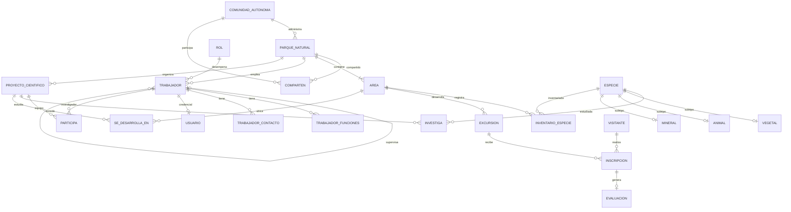

# Modelo relacional propuesto · Guía para reconstruir en MySQL Workbench

**No sustituye el diagrama EER obligatorio de Workbench**. El estudiante deberá comprobar cardinalidades y reflejar las correcciones aceptadas.

`AREA` se identifica con `(numCorrelativo, numInterno)`; `EXCURSION` con `(numCorrelativo, numInterno, codigoExcursion)`; `INSCRIPCION` usa surrogate `idInscripcion`; `EVALUACION` usa esta última como PK y FK. La especialización es parcial y disjunta en el MERE original y requiere refuerzo de integridad global.

**Pendiente para estudiantes:** corregir el MERE en ERDPlus, construir EER Workbench real y obtener capturas legibles.
